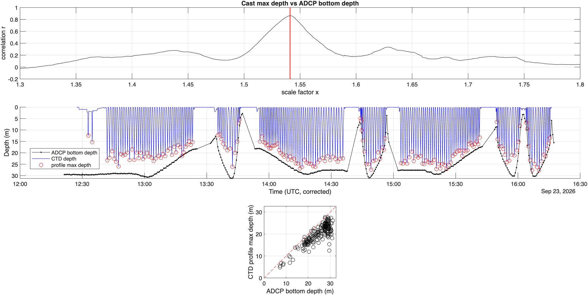
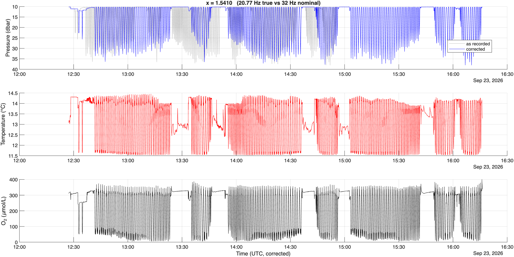
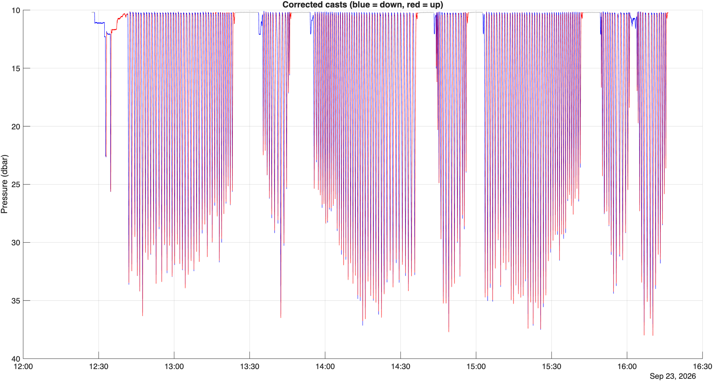

# A first stab at fixing the CTD sampling rate

As we all know the casting CTD was not actually sampling at 32 Hz like we all thought it was. So the timestamps for the CTD casts are all incorrect. Below I detail my first stab at trying to fix this. I go into depth describing a function I wrote with Claude. This code can be found in my GitHub repo for this project: 

I don't trust this reconstruction that I did (I go into why below), so any feedback is much appreciated!

## The details 

Based on what Alex found and what RBR said it seems the CTD was actually logging somewhere around 20.7-20.8 Hz. In my own exploration with Claude I found from the raw data that the timestamps are not all individually sampled. Like Alex's Claude session indicated the sensor uses the start time and then the sampling rate to construct the more miniscule timestamps. It also records the offload timestamp, but this is not super helpful. Without knowing the actual timestamps it is hard to get at the actual sampling rate because as we have found the sensor is self-consistent, and therefore it is difficult to know the exact stretching value that should be applied to the timestamps.

So, without knowing the true timestamp the fix gets a little tricky. I used claude to help me create this function that relates the CTD to the ADCP data. Essentially the function finds how deep each CTD cast went, according to the incorrect clock. It then read in the raw ADCP data from WinADCP and computes the seafloor depth from the four beams and adds the transducer depth so that the ADCP depth is referenced from the surface like the CTD. 

Assuming that the best way to determine the correct CTD time stamp. The corrected time should be t_corr = t0 + (t_i - t_0)*x where t_i is each time value from the CTD, so essentially t_i - t_0 is the duration from the start time. The x variable is the stretch factor needed to fix the time. Using the ADCP, the basic idea is that the deepest measurement of each CTD cast should track the bottom pretty well. So the function tries many stretch factors, x (from 1.3 to 1.8). For each of these points, the function moves every profile's deepest point to its "corrected time", looks up the ADCP bottom depth at that time, and then calculates the correlation between those two values. The x value with the highest correlation wins, and then the true rate is 32/x. It also reports how wide the correlation peak is which gives the uncertainty. 

I tried doing this with the September ebb casting data.

Here are the values that the function came up with :

samples: 285366   nominal rate: 32.000 Hz   nominal duration: 8917.7 s
  ADCP (raw WinADCP): bottom depth = mean of 4 beams + transducer depth; median beam spread 0.86 m
  ADCP: 477 ensembles, 12:20:16 -> 16:18:16, 88% with valid bottom depth
  true rate: 20.7657 Hz (from ADCP match)   x = fsNominal/fsTrue = 1.54100
  ADCP match at this x: r = 0.862
  x within 5% of best correlation: 1.5360 - 1.5455  (rate 20.71 - 20.83 Hz)

Logging (corrected, UTC): 2026-09-23 12:27:15.375  ->  2026-09-23 16:16:17.482
Logging (as recorded)   : 2026-09-23 12:27:15.375  ->  2026-09-23 14:55:53.031

The ending timestamp is certainly more correct here. Especially given that the CTD is offloaded about 2 minutes later according to the log. 

Here are some plots from this:

  
<figure>
  
  <figcaption class="fig-caption">Figure 1. The top panel shows the correlation r values calculated for different scale factors that I tried to use when fitting the CTD and ADCP bottom depths (see the description above). As you can see there is a clear peak at x (stretch factor) = 1.54. The middle panel shows the "corrected" timestamps for the CTD by plotting the CTD depth measurement and the ADCP bottom track. The red circles show the bottom CTD depth measurements that were used to match to the ADCP bottom track measurements in accordance with the x = 1.54 time correction. The third panel shows the relationship between the ADCP bottom depth and the CTD bottom depth with a 1:1 line.</figcaption>
</figure>
  

The top panel of this plot gives me some hope. There is a clear peak in the correlation value, which is what is reported above as x = fsNominal/fsTrue = 1.54100. This corresponds to a true sampling rate of 20.7657 Hz which falls between the values that Alex and RBR gave. This makes me a bit more confident. However, this correlation value is only r = 0.862, which I think is low. There is still 14% of the variance between these two samples that is unexplained. This also shows up in the third panel in this plot, which shows the scatter plot relationship between the ADCP depths and the CTD depths. The scatter shows that the ADCP values are often slightly larger than the CTD values. This makes sense given that we have been careful not to run the CTD into the ground while casting so we do not get super close to the bottom every time. 

A couple more helpful plots:

  
<figure>
  
  <figcaption class="fig-caption">Figure 2. The top panel shows the "as recorded" time series of pressure and the corrected time series. The two panels below that show the corrected temperature and DO profiles. </figcaption>
</figure>
  

We can see here that there is definitely an offset between the measured and corrected times. The corrected times extend well beyond the measured times and are consistent with the ADCP and our notes. 

  
<figure>
  
  <figcaption class="fig-caption">Figure 3. The corrected up and down casts. </figcaption>
</figure>
  

Not much to see here except that the upcasts follow the downcasts which is good to see validated. Also we can see that the upcast starts slightly high than the downcast which would be consistent with the pressure change that the sensor uses to determine when it is ascending or descending. This is not super relevant here but is good to know the CTD is working correctly. 

 

Overall, this is a first stab at trying to fix this CTD data. I don't trust this yet.

**Next steps:**
- Try to see if our notes for the last cast (or casts depending on how granular I want to go) are at all helpful for backing out the actual sampling rate. I might try to compare this method I did above to that method and see if that gets me anywhere.
- Use this method on other casting datasets to see if it is robust.

