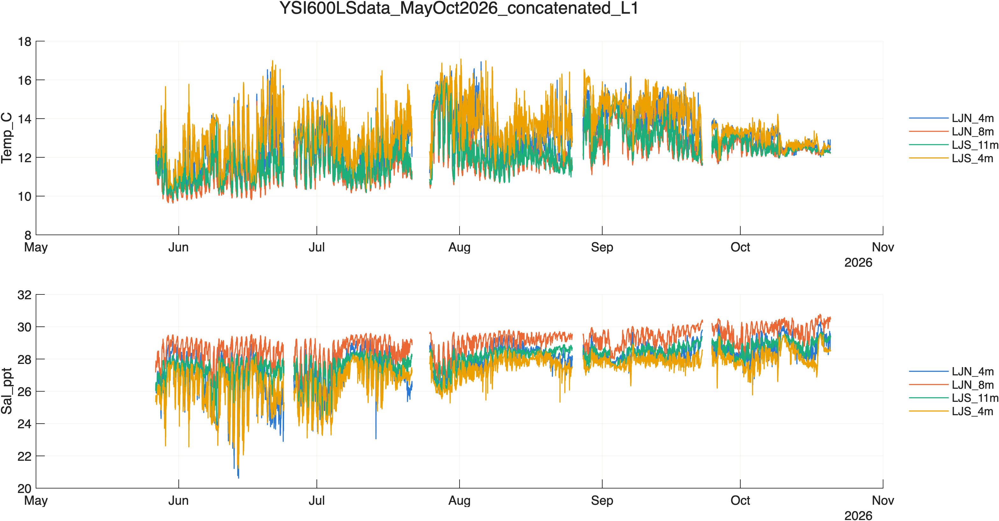
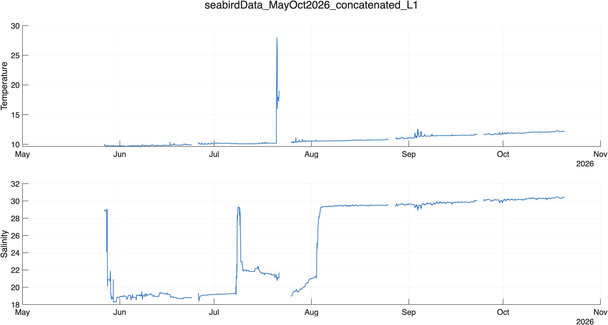

# Data update-- full time series

Since coming back from the field, my main goal has been concatenating, cleaning, and organizing all the data into a tidy structure. This is still in progress. But, I do have the fully concatenated, uncleaned time series for the mooring sensors. Exciting! These are below.

## The bottom-DO data from the TODOs

These sensors are located on the bottom of all the moorings. Those on the LoveJoy and Inner moorings sample every 1 minute and those on the bottom of the wire walkers sample once every 5 minutes. Note that the TODO on Wire Walker north instantly got submerged in the mud so the temperature reading is that of the bed, and the oxygen values are not useable and should not be interpreted.

  
<figure>
  
  <figcaption class="fig-caption">Figure 1. Bottom dissolved oxygen data. The sensors on the LoveJoy and Inner Moorings were reading every 1 minute, and the sensors on the bottom of the wire walker moorings were reading every 5 minutes. </figcaption>
</figure>
  

## The miniDOT data

These sensors were located mid-mooring on the LoveJoy line moorings. There were two miniDOTs per mooring. The other two miniDOTS were located in the Penn Cove Shellfish mussel rafts at 3m and 7m below the surface. They sample every 10 minutes.

  
<figure>
  
  <figcaption class="fig-caption">Figure 2. Dissolved oxygen and temperature data in the middle of the water column on the LoveJoy moorings and in the middle and on the bottom on the shellfish raft moorings. These sensors sample once every 10 minutes. </figcaption>
</figure>
  

## The YSI CTD data

These sensors were located in the upper part of the water column on the LoveJoy moorings. There were two sensors per mooring. They sample once every 10 minutes.

  
<figure>
  
  <figcaption class="fig-caption">Figure 3. Temperature and salinity measured in the upper-middle water column on the LoveJoy moorings. These sensors sample once every 10 minutes. </figcaption>
</figure>
  

## The soloT data

These sensors make up the bulk of the moorings line sensors on all found v4 SWIFT moorings (LoveJoy and Inner moorings). There are 7 soloT sensors on each mooring line. They read at a rate of 1 Hz. 

  
<figure>
  
  <figcaption class="fig-caption">Figure 4. Temperature measured at 1Hz at 7 discrete depths on each mooring. Exact depths have yet to be calculated </figcaption>
</figure>
  

## The SeaBird data

The SeaBird CTD was located on the bottom of the LoveJoy South mooring. It sampled every 10 minutes. For the first several months of deployment the tubing that led to the salinity sensor got filled with sediment, so the data quality is horrible. We ended up putting a float on the sensor in July, so the data quality got better beginning then.

  
<figure>
  
  <figcaption class="fig-caption">Figure 5. The Seabird CTD was located on the bottom of LoveJoy south. It sampled every 10 minutes. </figcaption>
</figure>
  

## The Bottom-mounted Concerto CTDs

## The Duo T.D. sensors

The Duos were located on the Inner moorings. Inner north had a Duo on the anchor, acting as a tide gage, and one on the line. Inner south only had one sensor on the line. From May-June these sensors measured at 1 Hz, but after that they measured at 10 seconds.

  
<figure>
  
  <figcaption class="fig-caption">Figure 7. The Duo temperature and depth sensors. These sensors measured at 1 Hz from May to June and then at 10 second intervals from June onward. </figcaption>
</figure>
  

