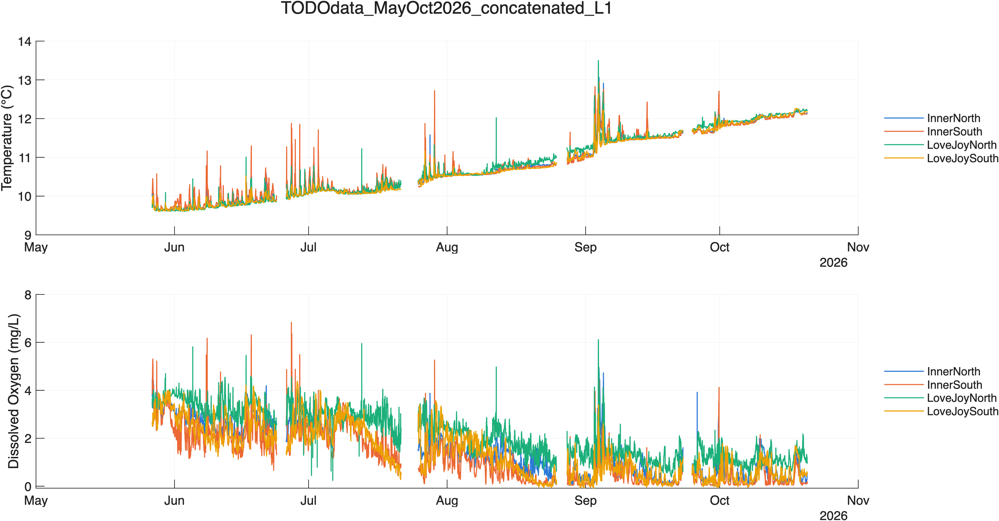
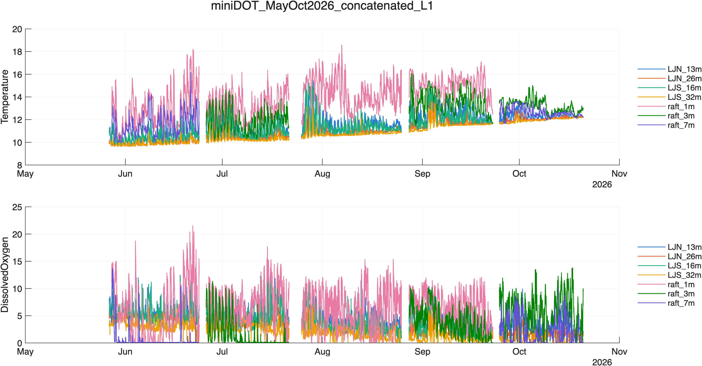
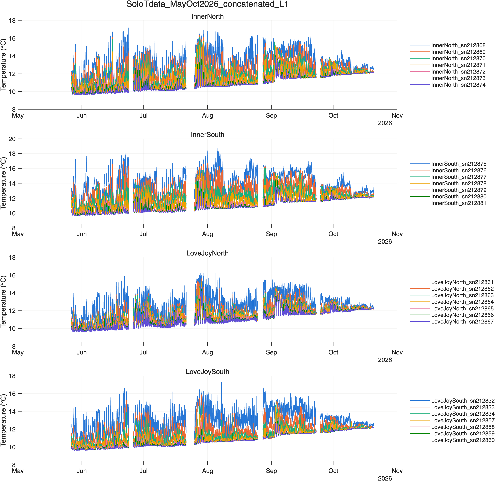
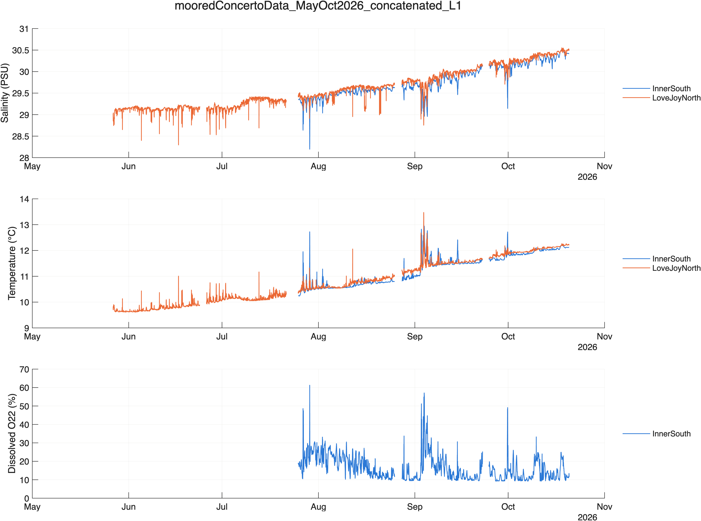
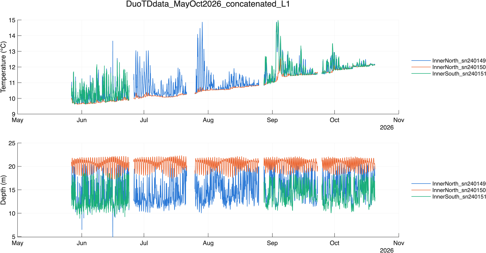

# Full time series from the v4 moorings

Since coming back from the field, my main goal has been concatenating, cleaning, and organizing all the data into a tidy structure. This is still in progress. But, I do have the fully concatenated, uncleaned time series for the mooring sensors. Exciting! These are below.

## Overall takeaways from the plots below

- Temperatures at the bottom of the water column and in the middle of the water column increased from around 9.5 degrees C to just over 12 degrees C throughout the course of the deployment. This is consistent at all moorings.

- Bottom dissolved oxygen decreased throughout the deployment (as we already know), as did oxygen levels in the middle of the water column. Lots of hypoxia!

- Visually, it looks like maximum salinity increased *slightly* from 29-30 PSU at all moorings and depths throughout the course of the deployment. My plan is to do a Mann Kendall test for a trend in the data after I get through all the organization and processing steps. 

- The variance in the temperature data decreases in September to October for all moorings and all sensors in the water column. There are some wind events that occur, but otherwise the data is steady.

- In July and August it looks like there is a kind of "waviness" to the temperature and salinity data? It is most noticeable in these months across the whole water column. In the bottom plot that shows the temperature and pressure data from the Duos, it looks like it might coincide with the Spring/Neap tidal variation. This is similar to the patterns we think we see in the Godin-filtered oxygen data. I think there is something to this! It is interesting it is most noticeable in these months, though. Maybe there is more Skagit discharge at this time? Or maybe not... See graph of discharge at the end of this blog post.

 

## The bottom-DO data from the TODOs

These sensors are located on the bottom of all the moorings. Those on the LoveJoy and Inner moorings sample every 1 minute and those on the bottom of the wire walkers sample once every 5 minutes. Note that the TODO on Wire Walker north instantly got submerged in the mud so the temperature reading is that of the bed, and the oxygen values are not useable and should not be interpreted.

  
<figure>
  
  <figcaption class="fig-caption">Figure 1. Bottom dissolved oxygen data. The sensors on the LoveJoy and Inner Moorings were reading every 1 minute, and the sensors on the bottom of the wire walker moorings were reading every 5 minutes. </figcaption>
</figure>
  

**Initial takeaways for this data**
- In the dissolved oxygen plot it is clear that LoveJoy north is consistently more oxygenated than the other moorings
- At the end of August, inner north was more oxygenated than LoveJoy south and inner south for a few days. This is interesting given that my current hypothesis is that the inner bay is more hypoxic due to slow flow. Maybe there is an event that happened at this point in time that caused this deviation?
- It looks like LoveJoy north might be warmer than the other locations beginning in late August. No idea why this is happening. 

## The miniDOT data

These sensors were located mid-mooring on the LoveJoy line moorings. There were two miniDOTs per mooring. The other two miniDOTS were located in the Penn Cove Shellfish mussel rafts at 3m and 7m below the surface. They sample every 10 minutes.

  
<figure>
  
  <figcaption class="fig-caption">Figure 2. Dissolved oxygen and temperature data in the middle of the water column on the LoveJoy moorings and in the middle and on the bottom on the shellfish raft moorings. These sensors sample once every 10 minutes. </figcaption>
</figure>
  

**Initial takeaways for this data**
- Wow, there are some serious naming inconsistencies in the raft data here. Basically we thought the miniDOT near the surface was at 1m below the surface until we discovered in July or August that is was actually attached at 3m below the surface. I forgot to go back and re-name the old data so there are three raft sensor colors that change from month to month when there should be two. This is something to fix and go back through this concatenation plotting carefully. I am going to disregard the other miniDOT data for now until I fix this and feel confident in this pattern.

## The YSI CTD data

These sensors were located in the upper part of the water column on the LoveJoy moorings. There were two sensors per mooring. They sample once every 10 minutes.

  
<figure>
  
  <figcaption class="fig-caption">Figure 3. Temperature and salinity measured in the upper-middle water column on the LoveJoy moorings. These sensors sample once every 10 minutes. </figcaption>
</figure>
  

**Initial takeaways for this data**
- Lots of spiky salinity data here, especially in June and July. This tapers off in the later months, so it makes me think that this is from changes in river discharge. In the Skagit discharge plot we can see late July is where the decline in discharge accelerates and there are no more jumps in discharge.
- I would say that these sensors have the most wobbliness in the whole dataset. Could this be from variation in depth?

## The soloT data

These sensors make up the bulk of the moorings line sensors on all found v4 SWIFT moorings (LoveJoy and Inner moorings). There are 7 soloT sensors on each mooring line. They read at a rate of 1 Hz. 

  
<figure>
  
  <figcaption class="fig-caption">Figure 4. Temperature measured at 1Hz at 7 discrete depths on each mooring. Exact depths have yet to be calculated </figcaption>
</figure>
  

**Initial takeaways for this data**
- There is so much here it is a bit overwhelming. I need to do a better job of putting the depths instead of the serial numbers as the labels to this plot. I will have this next time!
- It is hard to compare between moorings here. Any thoughts for a better way to plot this once all is cleaned and assigned a depth will be helpful.

## The SeaBird data

The SeaBird CTD was located on the bottom of the LoveJoy South mooring. It sampled every 10 minutes. For the first several months of deployment the tubing that led to the salinity sensor got filled with sediment, so the data quality is horrible. We ended up putting a float on the sensor in July, so the data quality got better beginning then.

  
<figure>
  
  <figcaption class="fig-caption">Figure 5. The Seabird CTD was located on the bottom of LoveJoy south. It sampled every 10 minutes. </figcaption>
</figure>
  

**Initial takeaways for this data**
- As I said above, you can see where this data quality is bad and then improves. Once it improves, you can see that the salinity and temperature values are similar to the other moorings. 

## The Bottom-mounted Concerto CTDs

From May through July only LoveJoy north had a concerto CTD at the bottom. From the end of July through August we added another concerto to the bottom of Inner north (thanks, Sam!). The concerto on the bottom of LoveJoy north took a measurement at 1 Hz for two seconds every 2 minutes (so essentially an average of two readings every 2 minutes). The concerto on the bottom of Inner north read once every 5 minutes at a sampling rate of ________ (I need to go back and look).

  
<figure>
  
  <figcaption class="fig-caption">Figure 6. The bottom-mounted Concerto CTDs were located on the bottom of LoveJoy north and Inner north. </figcaption>
</figure>
  

**Initial takeaways for this data**
- You can really see the waviness I was talking about in the salinity values here, especially in July. Also, it almost looks like there are two different trend slopes in the rising salinity values. The first from June to July, when river discharge was high, shows a slow increase or maybe even none at all (Mann Kendall soon!), and then in late July and early August the salinity quickly increases at the bottom. Maybe this is not tidally-forced but is instead dependent on the Skagit! We see the "wavy" trend in the salinity, temperature, and DO data (see my Godin filtered DO blog post from a while ago)... maybe it is not the tides that are forcing these patterns but instead Skagit River discharge?

- 
## The Duo T.D. sensors

The Duos were located on the Inner moorings. Inner north had a Duo on the anchor, acting as a tide gage, and one on the line. Inner south only had one sensor on the line. From May-June these sensors measured at 1 Hz, but after that they measured at 10 seconds.

  
<figure>
  
  <figcaption class="fig-caption">Figure 7. The Duo temperature and depth sensors. These sensors measured at 1 Hz from May to June and then at 10 second intervals from June onward. </figcaption>
</figure>
  

## Skagit River discharge from Mt. Vernon station from May 1 - Nov 1, 2026

 

## Next steps for this data (hopefully by Thanksgiving)

1) De-spiking
2) Figuring out the depths for all the sensors at a given time with the SWIFT watch circle
3) Putting everything in data structures: right now there are 3 planned: one for the raw data and the different sampling intervals, one for de-spiked data at the different sampling intervals, one that is worked into the SWIFT structure that is on the same 30 minute timestamps as the SWIFT measurements. 

